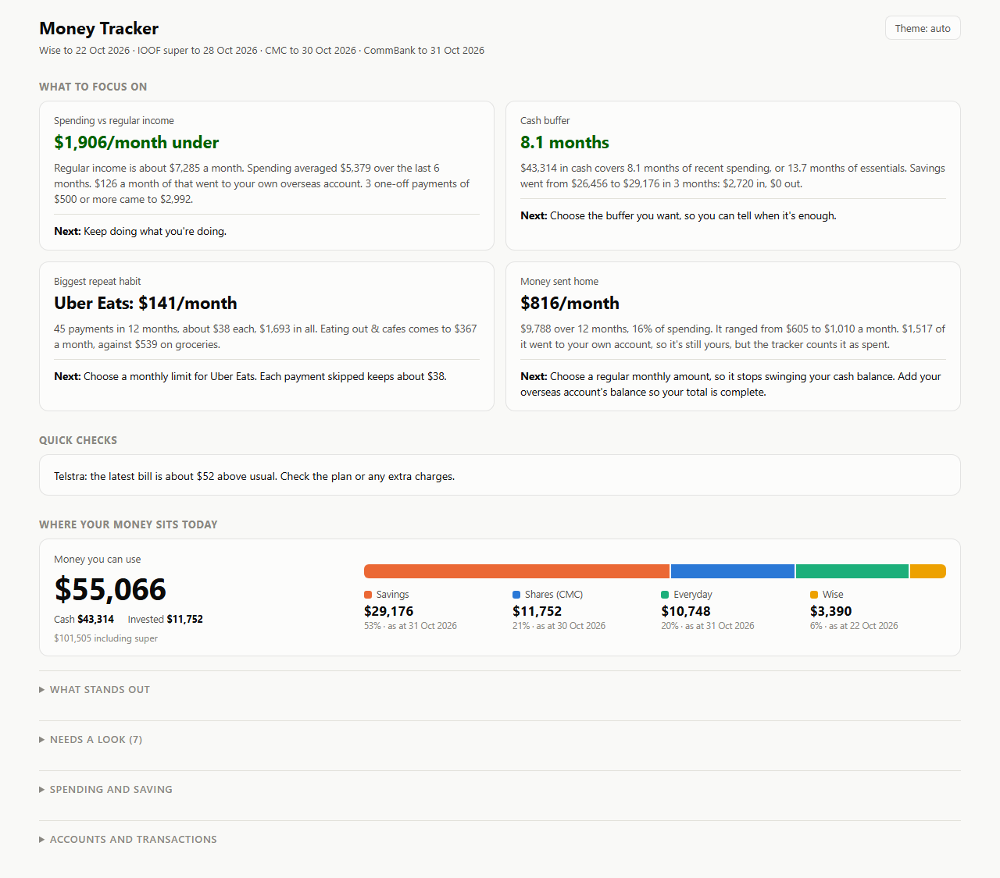
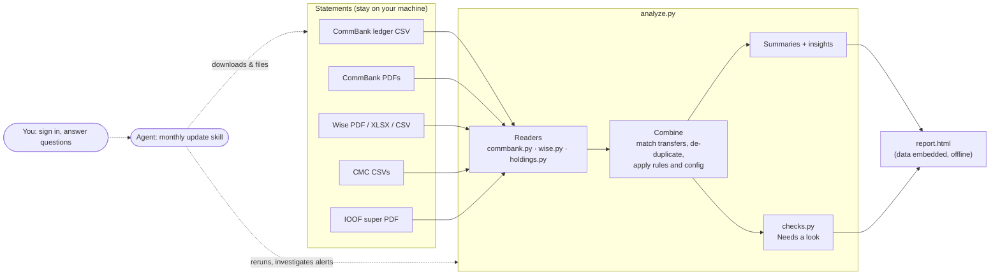
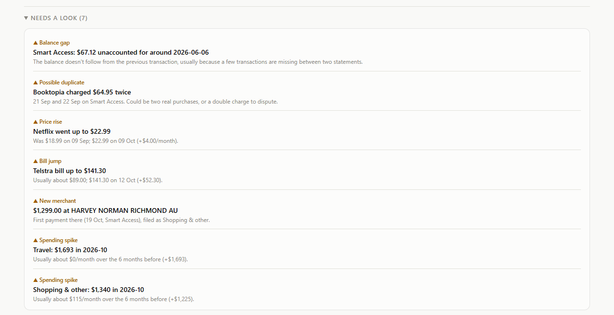
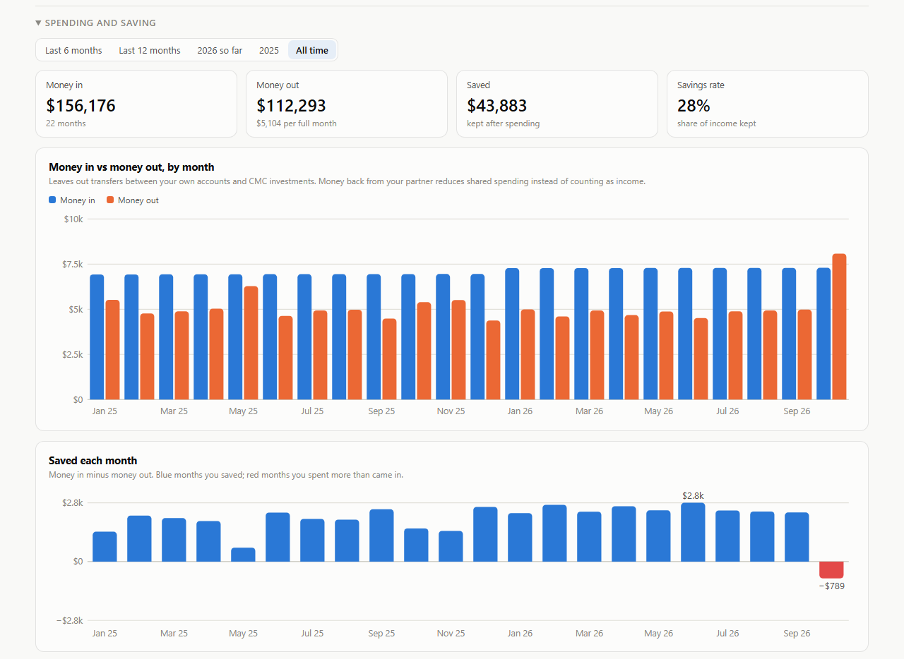
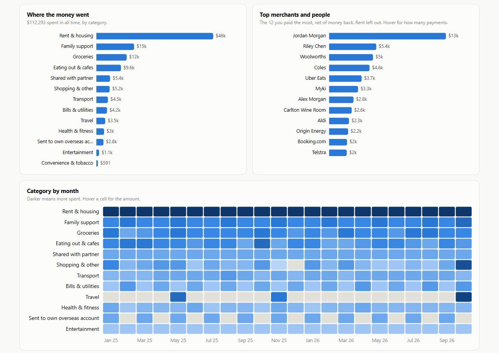
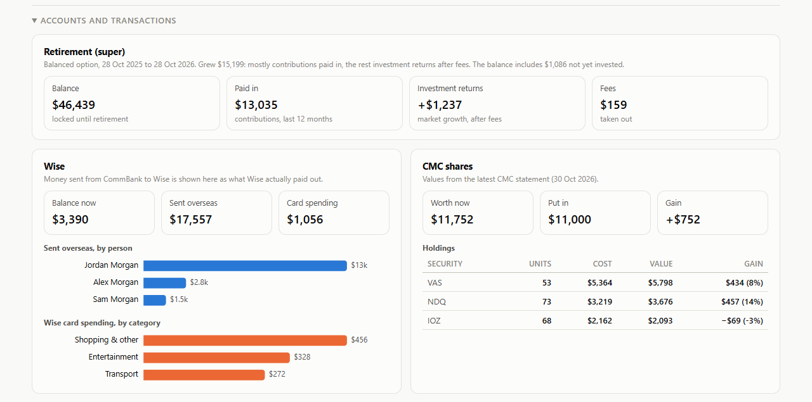
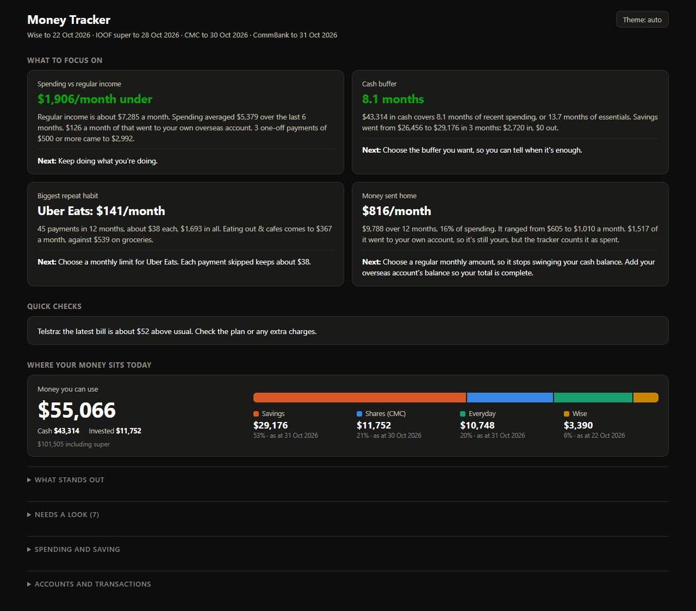

# Money Tracker

[](https://github.com/sarthaksansar/money-tracker/actions/workflows/ci.yml)

**Turns raw statements from four financial institutions into one private, offline report: where your money
sits, where it went, and what looks wrong. An AI agent runs the monthly update, within rules that keep
the human in charge.**

[**Live demo**](https://sarthaksansar.github.io/money-tracker/) (built from generated fake data) ·
[How it works](#how-it-works) · [Try it](#try-it)



## Why it exists

My money is spread across a bank (CommBank), a multi-currency account (Wise), a share broker (CMC Invest) and a
super fund (IOOF). Each exports a different format, the same dollar often appears in two of them, and none
of them tells you whether a charge looks wrong. Budgeting apps want bank logins. This keeps statements on my
machine, does the reconciliation in plain Python, and produces a single HTML file that loads nothing from the
internet.

## Highlights

- **Combining sources without double counting.** A transfer from the bank to Wise appears in both. It's replaced
  by what Wise actually paid out and to whom, matched within 5 days with Wise's fee allowed for. Export formats
  that overlap and spell IDs differently are de-duplicated, and a ledger and newer PDFs that overlap on the same
  day are joined without repeats.
- **An agent-run monthly update with guardrails.** A [Claude Code skill](.claude/skills/update-statements/SKILL.md)
  downloads the new statements in a browser, files them, rebuilds the report and investigates every alert
  before involving me. I sign in myself; it asks before each download, always logs off, never moves money, and
  updates its own runbook when a website changes.
- **Checks that explain themselves.** Duplicate charges, subscription price rises, bill jumps, big first-time
  merchants, category spikes and balance gaps, each tuned against false alarms (a daily $5.50 coffee is not a
  duplicate) and each saying why it fired.
- **A dashboard that starts with what matters.** The top of the report is a few findings, each with one next
  step, plus this month's quick checks. Charts, accounts and transactions stay folded away until you want them.
- **One self-contained report.** Hand-drawn SVG charts, light and dark themes, no libraries, no network.
- **Tested on realistic fake data.** A generator writes every statement format the readers handle, with one of
  each problem planted; the tests run the whole pipeline on it.

## Try it

Needs Python 3.11+.

```bash
pip install -r requirements.txt -r requirements-dev.txt
python generate_sample.py      # writes fake statements to sample_data/
python analyze.py              # prints the summary and opens report.html
pytest                         # runs the pipeline end to end on fresh fake data
```

Without a `config.toml`, everything uses `config.example.toml`, which points at the fake data. To use your own
statements, copy it to `config.toml` (git-ignored) and fill in your folder, names and recipients.

## How it works



### Combining sources

The interesting part is that the same money shows up in more than one place:

| Situation | What the code does |
| --- | --- |
| Bank pays $1,000 to Wise, then Wise sends $600 + $4.80 fee to family | The bank line is dropped once it matches a Wise top-up of the same amount (or amount + fee) within 5 days; the Wise send is what's counted, under *Family support*. |
| A Wise transfer paid straight from the bank card (never touches the Wise balance) | No top-up exists, so the bank line is matched to the send itself: it's counted once, as the payment to the recipient. |
| Wise PDF, Excel and CSV exports overlap, and spell card IDs `CARD_TRANSACTION-123` vs `CARD-123` | IDs are normalised and each transaction is kept once. Fees, which the Excel export lists as separate rows, are folded into their transaction. |
| The bank ledger was made partway through its last day; newer PDFs start that same day | For that day, only transactions the ledger doesn't already have (by account, date and amount) are added; newer rows borrow the category the ledger last used for that merchant. |
| A partner pays you back for shared costs | Money back reduces spending in that category instead of counting as income. |
| Money moved to the share broker | Counted as invested, not spent. |
| A statement is missing | Each balance should equal the previous balance plus the amount; when it doesn't, *Balance gap* says roughly where. |

### Needs a look



| Check | Fires when | Avoids |
| --- | --- | --- |
| Possible duplicate | Same merchant, amount and account on the same or next day, in the last 90 days, $20+ | Amounts that recur there (a daily coffee) |
| Price rise | A monthly charge (median gap 25–35 days) rises $2+ and 5%+ | Charges whose amounts already vary |
| Bill jump | A recurring bill is $20+ and 30%+ above its usual amount | Normal month-to-month wobble |
| New merchant | $250+ somewhere never paid before, in the last 60 days | Rent and transfers to people |
| Spending spike | Last full month in a category is $300+ above and 1.5× its 6-month average | The month still in progress |
| Balance gap | A balance doesn't follow from the previous one | – |

### The monthly update

The code is deterministic; the agent does the parts that need a browser or judgement, and the human
does the parts that need a person. The [skill](.claude/skills/update-statements/SKILL.md) spells out:

1. **Find what's stale:** run the report and read the *Data up to* list (sources older than 31 days are flagged).
2. **Download per provider:** open each login page and wait for me to sign in; ask before each download;
   check each file's account and date range; rename to a convention the readers rely on; log off.
3. **Rebuild and verify:** balances must match what the site showed to the cent.
4. **Investigate alerts first:** read the surrounding transactions and settle what the data can settle
   (a refund that cancels a "duplicate", a known merchant under a new name); bring me only what needs my
   knowledge or action, with a suggested next step.
5. **Keep the runbook current:** when a site's menus change, update the skill so next month is quicker.

Hard rules: the agent never types passwords, never moves money or disputes a charge, and never saves a statement
anywhere but the private data folder.

### More of the report





<details>
<summary>Dark theme</summary>


</details>

## Privacy by design

- Statements, `config.toml`, your rules and the generated report are git-ignored; this repository holds only
  code and fake data.
- Everything personal (names, recipients, folders, report wording) lives in `config.toml`, so the code and the
  report template contain nothing about any one person.
- The report embeds its data and loads nothing from the internet.
- Every screenshot here comes from `generate_sample.py`.

## Project layout

| File | Role |
| --- | --- |
| `analyze.py` | Loads everything, combines sources, builds insights, writes the report |
| `commbank.py`, `wise.py`, `holdings.py` | Readers for each provider's statement formats |
| `checks.py` | The *Needs a look* checks |
| `report_template.html` | The report: layout, SVG charts and filters |
| `config.py`, `config.example.toml` | Personal settings, kept out of the code |
| `generate_sample.py` | Writes a full set of realistic fake statements |
| `tests/` | End-to-end tests on generated data |
| `.claude/skills/update-statements/` | The agent's monthly-update runbook |
| `.github/workflows/` | Tests on every push; the live demo, rebuilt from fake data |

## Limitations

- The readers handle the statement formats of four Australian providers; another bank needs a new reader.
- PDF parsing depends on each provider's layout, so a redesign means updating a regular expression.
- Wise's balance exports carry no card categories, so those payments land in *Shopping & other* unless a rule
  says otherwise.

## Licence

[MIT](LICENSE)
